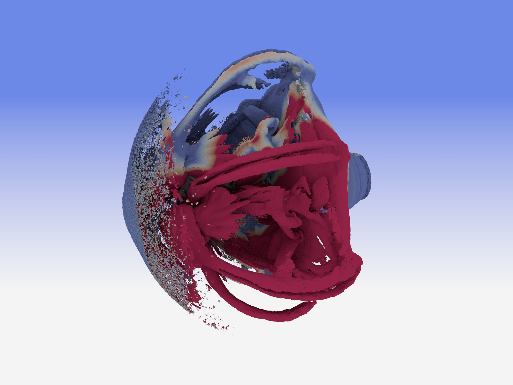
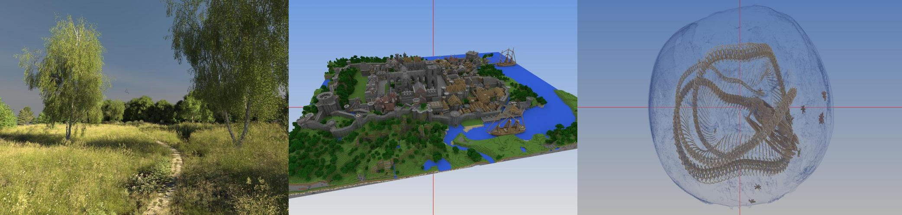
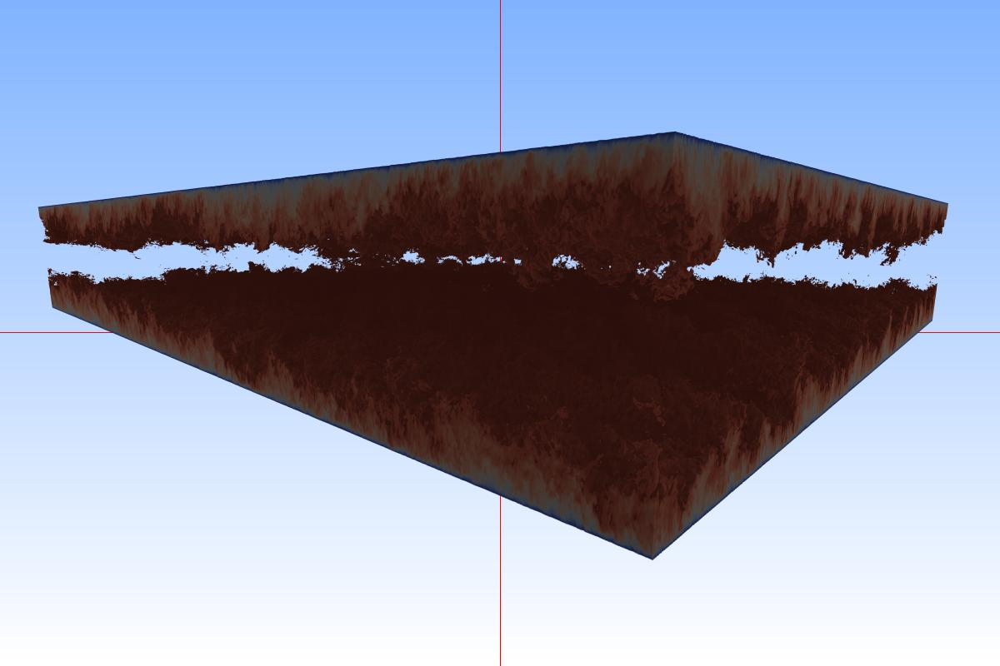
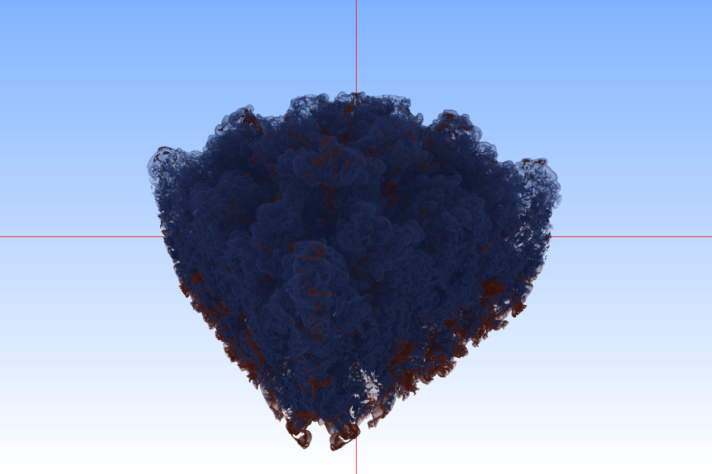
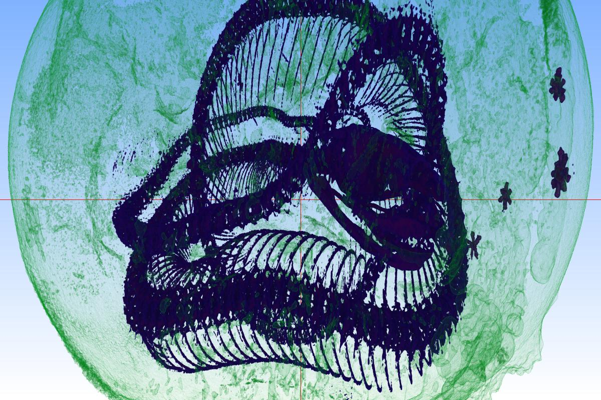
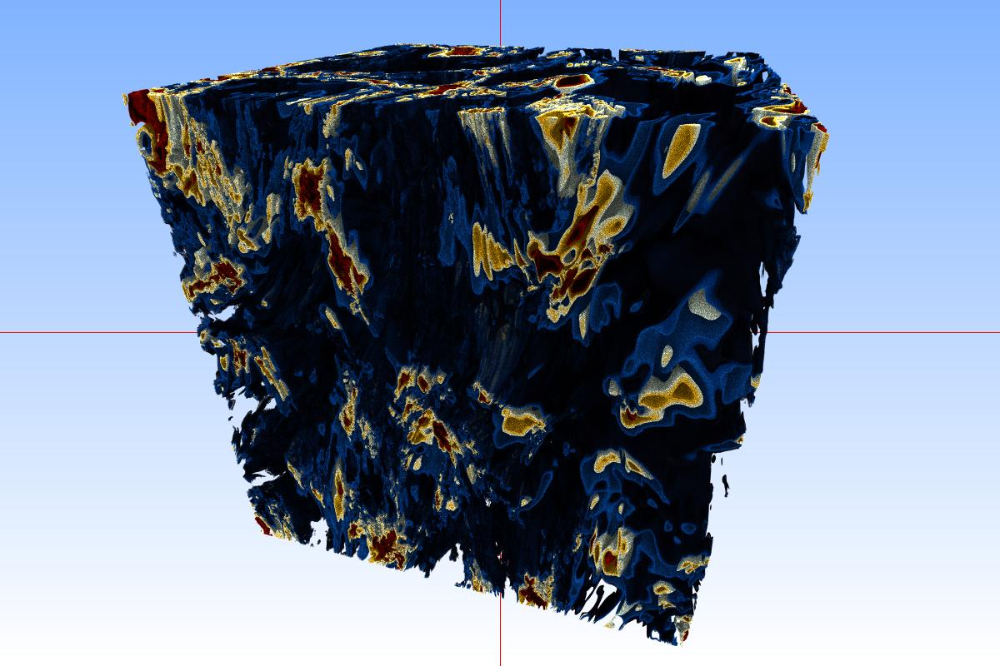
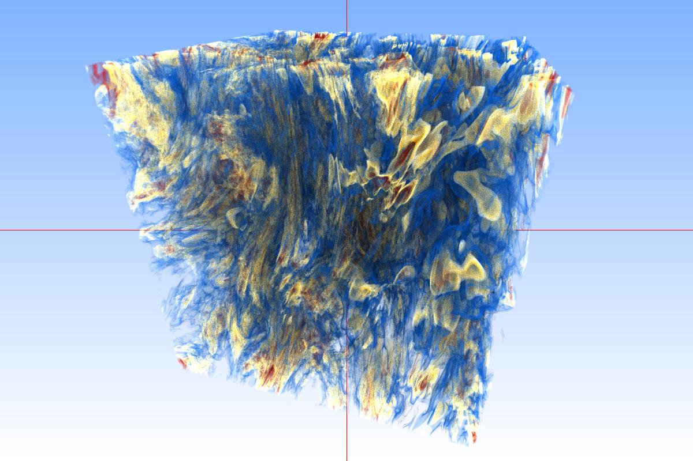
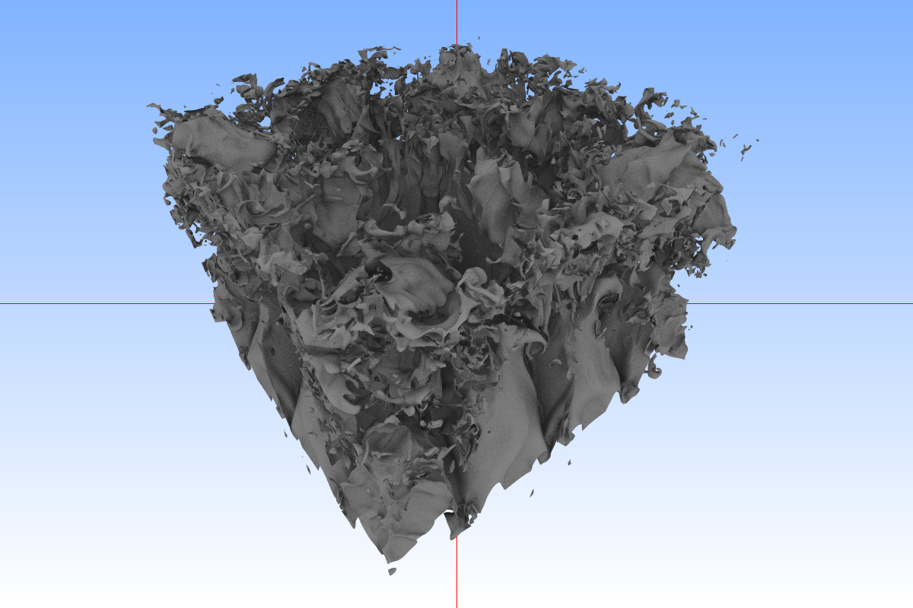

# HayStack

# Building and Running

### linux package dependencies

    sudo apt install libtbb-dev cmake-curses-gui libglfw3-dev build-essential libopenmpi-dev libucx-dev libpmix-dev libgtk-3-dev

### MPI

To build *haystack* with MPI support, make sure to use `-DHS_MPI=ON` when configuring the project.

# Command Line Options

Though haystack has an interactive viewer it is still largely driven
my command line paramters. In no particular order:

### Camera related:

- `--camera pv py pz cx cv cz ux uy uz`: specifies position
  (px,py,pz), center of what the camera is aiming at (cx, cy, cz) and
  upvector (ux,uy,uz) of the camera
- `-fovy deg`: camera field of view, in y direction, in degrees.

### Lights related:

- `--dir-light  dx dy dz  rx ry rz`: direction (d) and radiance (r) of a
  directional ("distant") light source
- `--quad-light cx cy cz  e0x e0y e0z e1x e1y e1z  Ex Ey Ez`: a directed
  (one-sided) quadrangular light soure, specified through corner (c),
  and its two edge vectors (e0 and e1), as well as emission (E)
- `--quad-light-centered  cx cy cz  e0x e0y e0z  e1x e1y e1z  Ex Ey Ez`:
  same as `--quad-light` except c specifies the *center* of the
  light source
- `--lights miniFileWithLights.mini`: given a scene of light sources
  in miniScene format, this loads all the lights sources from this
  model and makes sure they are on all ranks. This will *not* load the
  geometry from this model, only the light sources - but it will
  replicate them across all ranks.
- `--env-map miniWithEnvMap.mini`: same as '--lights', but
  specifically for an environment map. will at some point get
  superseded by --lights.

### Multi-GPU and/or Multi-Node Parallel Rendering Related:

- `-ndg int`: number of parallel 'data groups' (ie, 'partitions') to
  partition the input content(s) over. Each resource specifier (see
  below) can generate one or more 'pieces' of data; haystack will then
  partition these into the requested number of data groups. It is THIS
  value that specified the number of data parallel partitions for data
  parallel rendering. If intending to render 8-wide data parallel (8
  mpi ranks, or 8 gpus in a single-process/multi-gpu manner), one has
  to be specify -ndg 8.
- `-dp` request data parallel rendering. input data gets partitioned into
  'ndg' partitions, and every set of ndg machines gets one piece of data each
- `-dr` request data *replicated* rendering; all rangs will get all content.

### Unordered:

- `-o filename.png`: file to render to, in offline mode
- `-spp int`: number of samples/paths per pixel
- `--measure`: render for given number of frames/seconds, and print time per frame
- `--bg-color r g b a`: specify (constant) background color
- `--ambient float`: ambient illumination

# Loadable Content Specifiers

Every command line argument passed to haystack that is not in itself a
`-arg` or `--argument` style paramter will be interpreted as a
"content specifier" that specifies some kind of renderable content
that haystack is to render. This is typically a filename, optionally
with some 'type specifier' that specifies what kind of loader to use
for that, plus optionally some arguments for this particular
loader. In some cases the specific content can also be procedural, not
a file, but otherwise the same logic applies.

## Loadable Resource Descriptors: 

Any content specifier (in haystack also called a 'data URL') looks
like this: `[contentType://][<N>@]contentDescriptor[:arg=value]*`

In this, 

- `contentDescriptor` is typically a filename, such as `truck.mini` or
  `~/models/truck.obj`. In some cases it can also be a prodcedural
  content generator.
- `contentType://` specifies the type of content loader to use for
  this content descriptor/content file. E.g., `obj://` would request an
  obj loader, `spheres://` describes a flexible type of binary files
  with spheres in them, etc. A list of supported content specifiers is
  given below. `contentType://` is optional if the type can be inferred
  from the file ame extension, but is required if either `N@` or any
  parameters are being used even if type could otherwise be derived from
  file name.

- `<N>@` requests that haystack partition this particular content/file
  on-the-fly while loading. I.e., `ts.tri://8@triangles.tri` would
  request to treat the file `triangles.tri` as if it was 8 separate
  files with one-eigth of the triangles. Different content loaders may
  interpret differently what 'pre-partitioning' means, some may not
  support it at all.
  
- `:arg=value` pairs. Any number of `:arg0=value0:arg1=value0:...` can
  be appended to any content descriptor, from where the respective
  loader can read them when it starts to read that content. What
  arguments a loader understands - and what format it expects the
  values to be in - depends on the loader.
  
## Currently Supported Resource specifiers

Haystack currently supports the following 'file format'/content descriptors:

### `ts.tri://`: tim-sanstrom binary triangles file format. 

Content descriptor is a (binary) file made up of floats that form
triangles. Each triangle is three vertices, where each vertex is made
up of 'stride' floats, the first three of which are x,y,z position,
and others can be used for color mapping. Supported parameters:
  
- `begin=int64`: first triangle to read from this file. first 'begin' tris will simply get ignored.
- `count=int64`: number of triangles to read from this, starting at begin.
- `stride=int`: number of floats per vertex. first three are always x,y,z.
- `sidx=int`: index in per-vertex floats to use for as a scalar for
  scalar-to-color mapping. Eg, `:stride=4:sidx=3` would mean that each
  vertex has four floats, three for position, and fourth (sidx=3) is
  mapped to a color. if not specified no scalar to color mapping
  occurs.
- 'cidx=int': index/offset for an explicit rgb color per vertex. Eg
  `stride=6,cidx=3` would specify that each vertex has 6 floats, three
  for position, and a rgb color value at offset 3.
- any color-mapper specific parameters see below
- any anari material specific parameters see below

### `spheres://`: Binary spheres file format. 

Content descriptor is a (binary) file made up of floats that form
spheres. Each sphere is made up of 'stride' floats, the first three of which are x,y,z position,
and others can be used for color mapping. Supported parameters:
  
- `begin=int64`: first triangle to read from this file. first 'begin' tris will simply get ignored.
- `count=int64`: number of triangles to read from this, starting at begin.
- `stride=int`: number of floats per vertex. first three are always x,y,z.
- `sidx=int`: index in per-vertex floats to use for as a scalar for
  scalar-to-color mapping. Eg, `:stride=4:sidx=3` would mean that each
  vertex has four floats, three for position, and fourth (sidx=3) is
  mapped to a color. if not specified no scalar to color mapping
  occurs.
- 'cidx=int': index/offset for an explicit rgb color per vertex. Eg
  `stride=6,cidx=3` would specify that each vertex has 6 floats, three
  for position, and a rgb color value at offset 3.
- 'ridx=int': index of which float specifies a per-particle radius. If
  not specifies we use the 'radius' value.
- `radius=float`: a global radius to use for each sphere, when ridx is not set.
- any color-mapper specific parameters see below
- any anari material specific parameters see below


### Anari Material related arguments

Not all, but some resource speficiers allow specifying and
ANARIMaterial to be used for the specifig geomety(ies) that this
loader produces. If so, the following arguments are recognized:

- `:baseColor=r,g,b`: specifies base color, default is 1,1,1
- `:emissive=r,g,b`: specifies emissive component of material, default is 0,0,0
- ':roughness=<float>`: roughness, usually around 0.1..0.2 for some sort of glossy lobe
- ':metallic=<float>`: how metallic the material is, in [0,1]
- ':opacity=<float>`: opacity, in [0,1].

Note that some resource loaders may still set other values that
supersede these parameters. For example a `ts.tri` loader may allow to
set the baseColor, but may also set some color-mapping, which
supersede the basecolor in rendering.

### Color-mapper related arguemtns

Not all, but some resource specifiers allow to specify on-the-fly
scalar-to-color mapping (ie, color mapping that happens during load
time, not a transfer function applied to a volume). If so, the
following arguments are recognized:

- `:map=lo,hi` specified input domain for the color mapping, i.e., any
  scalar at or below 'lo' will be mapped to the lower end of the color
  range, and any scalar at or above hi will be mapped to the end of
  the color range. Eg, assuming a 'cold to hot' color map was used
  (see below), and a `:map=-20,80` was specified as input domain, any
  scalar <= -20 would appear 'cold', andy >= 80 would be 'hot' and any
  in-between would fall somewhere in-between.
- `:map-colors=<filename>`: points to a file name with colors to be
  used for color mapping. file is expected to be in ascii, with four
  floats (r,g,b,a) per line. 'a' is currently ignored.
- `:map-index=int` refers to a set of built-in color maps such as
  'paraview cool/warm', 'covise', 'virdis', etc. map index of -1 means 
  'temperature-to-rgb'


# Example Data Sets and How to Run Them

## Colored Iso-surface of Mars Lander 



- download from google drive using this link https://drive.google.com/file/d/1E7QEQ1H-JjPAIjCnCryv2yAqQ2egMiKq/view?usp=sharing
- unpack `tar xavf lander-iso_vortMag_2.4_mapped_w.tgz`
- load `.tstri1` files with haystack:

```
hsOffline lander-iso_vortMag_2.4_mapped_w/*tstri1 \
	-os 1600 1200
	-o lander-iso_vortMag_2.4_mapped_w.png
```
File format for this data: `.tstri1` is 
- all binary file, one triangle after another
- each triangle is three vertices, no connectivity
- each vertex is three floats position, plus one float scalar
 (scalar to color mapping currently happens in loader, tstri1 files
  do not specify how this mapping happens)

## Quick-Tests, for raw (structured) and mini (triangle meshes) files:



``` bash
./hsViewerQT ~/mini/ls.mini 

./hsViewerQT ~/mini/ls.mini `cat data/ls.cam`

./hsViewerQT ~/mini/rungholt.mini `cat data/rungholt.cam`

./hsViewerQT raw:///cluster/kingsnake_1024x1024x795_uint8.raw:format=uint8:dims=1024,1024,795 `cat data/kingsnake.cam` -xf data/kingsnake.xf
```


# DEPRECATED: 

## "Fun3D Lander"

Lander is a data dump from the NASA Fun3D unstructured mesh simulation
code. Of particular interest is that Fun3D is using mpi-parallel CFD,
and in its data dump stores not ony the final resulting tets, hexes,
scalrs, etc, but actually stores "per rank" information as well; i.e.,
we can reproduce exactly which rank had had which data during
simulation --- meaning this makes for a really good "strawman" for
in-situ rendering. 

Some high-level data:

- Lander-small: 144.9M vertices, ca 800M elements (mostly but not all
  tets). Data internally organized in *72* per-rank meshes. Good field
  to visualize `vort_mag`, time step `9000`

- Lander-large: Data internally organized in *552*(?) per-rank meshes.

### Conversion/importing progress

Original lander data dump from Fun3D looks like this:

    wald@hasky:~/models$ ll unstructured/lander-small
    total 25k
    drwxrwxr-x 4 wald wald 4.1k Sep 28  2020 ./
    drwx------ 3 wald wald 4.1k Nov 17 14:40 ../
    drwxrwxr-x 2 wald wald 4.1k Sep 28  2020 10000unsteadyiters/
    drwxrwxr-x 2 wald wald  13k Sep 28  2020 geometry/

In the following I assume the original fun3d data is in
`~/models/unstructured/lander-small/`. I also assume you have cloned
and built the `umesh` helper library (https://gitlab.com/ingowald/umesh).

To convert such data:

1) figure out what kind of variables and time steps are contained in
this dump:

    ./umeshBreakApartFun3D ~/models/unstructured/lander-small/geometry/dAgpu0145_Fa_me --scalars ~/models/unstructured/lander-small/10000unsteadyiters/dAgpu0145_Fa_volume_data.
	
for small lander, `vort_mag` and `9000` are good variable and time
step to visualize.

2) convert to per-rank umesh data:

    ./umeshBreakApartFun3D ~/models/unstructured/lander-small/geometry/dAgpu0145_Fa_me --scalars ~/models/unstructured/lander-small/10000unsteadyiters/dAgpu0145_Fa_volume_data. -ts 9000 -var vort_mag -o ~/per-rank/lander-small-vort_mag-9000.

This should (for small lander) create 72 different umesh files in `~/per-rank/`

3) To render in barney/haystack, simply pass all umesh files on the cmdline

    mpirun <mpiconfig> ./hsViewer ~/per-rank/lander-small-vort_mag-9000.* lander-small-surface.obj -ndg <numgroups> 
   
The `lander-small-surface.obj` file contains the triangular surface of the lander that is supposed to be 'inside' the volume. It can be found here: https://drive.google.com/file/d/11i8bw_ND388rOftfRXqQwdbV8zmcCxQV/view?usp=sharing

Notes:

- it is suggested to use a pre-saved transfer function. (TODO: where
  to get/find one?)
  


## Spheres (`priya` data set)


    ./hsViewerQT spheres:///cluster/priya/105000.p4:format=xyzi:radius=1  --camera 33.7268 519.912 545.901 499.61 166.807 -72.1014 0 1 0 -fovy 60


## (Offline-)data parallel on structured data

    mm && /home/wald/opt/bin/mpirun -n 4 ./hsOffline raw://4@/home/wald/models/magnetic-512-volume/magnetic-512-volume.raw:format=float:dims=512,512,512 --camera 33.0947 773.916 567.922 282.57 317.985 188.347 0 0 1 -fovy 60 -xf /home/wald/models/magnetic-512-volume/magnetic-512-volume.xf -o hs.png --num-frames 8 -ndg 4

- this is for 4 ranks; when using more make sure to change all three of `-ndg X`, `mpirun -n X` and `raw://X@...`!


## Tim Sandstrom "Spheres and Triangles" Data

To run the "jahmad" model (from Tim Sandstom at AMES)  -including spheres and a hex-helicopter surface mock-up -- use this:

    mpirun -n 8 -host $HOSTS ./hsViewer spheres://8@/cluster/sandstrom-spheres/jahmad/30172.xyz.flt.1:radius=.003 -ndg 8 ts.tri:///cluster/sandstrom-spheres/jahmad/srf.30172.tri
	
Make sure to adjust `count=` `-ndg` and `16@` values when running on a
larger machine (the above is for dual-RTX 8000, single workstation)


## Engine

    /home/wald/opt/bin/mpirun -n 2 /cluster/hsViewerQT raw://2@/cluster/engine_256x256x128_uint8.raw:format=uint8:dims=256,256,128 -xf /cluster/engine.xf --camera 316.657 220.631 67.4258 128.608 103.132 38.6924 0 0 1 -fovy 60

## DNS-one-eighth

Single-node, dual-gpu, multi-gpu data-parallel (no MPI):

    ./hsViewerQT raw://2@/cluster/dns-one-eighth-5120-3840-768.raw:format=float:dims=5120,3840,768 -ndg 2  --camera -456.228 4753.82 611.822 2376.76 1678.84 -150.28 0 0 1 -fovy 60 -xf /cluster/dns-one-eighth.xf
	


same w/ MPI, single node:

    /home/wald/opt/bin/mpirun -n 2 -host localhost:2 /cluster/hsViewerQT raw://2@/cluster/dns-one-eighth-5120-3840-768.raw:format=float:dims=5120,3840,768 -ndg 2  --camera -456.228 4753.82 611.822 2376.76 1678.84 -150.28 0 0 1 -fovy 60 -xf /cluster/dns-one-eighth.xf

## Structured Data: LLNL (subset, so it also runs on laptop)



### Local-node Rendering

    ./hsViewerQT raw:///home/wald/models/structured/llnl_0250.raw:format=uint8:dims=2048,2048,1920:extract=512,512,512,1024,1024,1024 --camera 2066.13 1846.6 242.936 1061.26 1013.85 971.708 0 0 -1 -fovy 60 -xf /home/wald/models/structured/llnl.xf

### Data-Parallel Rendering

To run data parallel (in this case, 2):
- run with mpirun
- change `raw://<path>` to `raw://2@<path>` (in this case, to split into 2 parts)
- specify num data groups to, in this example, 2:  `-ndg 2`

    /home/wald/opt/bin/mpirun -n 2 ./hsViewerQT raw://2@/home/wald/models/structured/llnl_0250.raw:format=uint8:dims=2048,2048,1920:extract=512,512,512,1024,1024,1024 --camera 2066.13 1846.6 242.936 1061.26 1013.85 971.708 0 0 -1 -fovy 60 -xf /home/wald/models/structured/llnl.xf -ndg 2


## Data-Parallel Banari, Structured Data

assumes that libanari_library_barney and libanari etc are all in same dir

### KingSnake (1024x1024x795)



    /home/wald/opt/bin/mpirun -n 2 /home/wald/Projects/hayStack/with-hanari/hsViewerQT raw://2@/mnt/raid/new_models/raw/kingsnake_1024x1024x795_uint8.raw:format=uint8:dims=1024,1024,795 -ndg 2 -xf /home/wald/Projects/hayStack/data/kingsnake.xf `cat /home/wald/Projects/hayStack/data/kingsnake.cam`

### kingsnake (1024x1024x795) 2 ranks, 4 gpus

	/home/wald/opt/bin/mpirun -n 4 -x LD_LIBRARY_PATH=/mnt/nfs/wald/opt/lib -host trinity:2,wally:2 /mnt/nfs/wald/hsViewerQT raw://4@/mnt/nfs/shared/raw/kingsnake_1024x1024x795_uint8.raw:format=uint8:dims=1024,1024,795 -ndg 4 -xf /mnt/nfs/shared/raw/kingsnake.xf `cat /mnt/nfs/shared/raw/kingsnake.cam`


### `rotstrat` (`4096x4096x4096_float`, 256GB)

`rotstrat` is large - 256GB - you'll need to run data parallel. E.g.:

	/home/wald/opt/bin/mpirun -n 8 $HOSTS /home/wald/Projects/hayStack/bin/hsViewerQT raw://8@/cluster/rotstrat_temperature_4096x4096x4096_float32.raw:format=float:dims=4096,4094,4096:extract=0,0,0,1024,1024,1024 -ndg 8 -xf /cluster/rotstrat-dense.xf  --camera 4666.62 -3069.99 663.698 2126.13 1007.38 1887.62 1 0 0 -fovy 60

With dense XF:


With more 'fuzzy' XF:


- not yet tested with hanari/banari


## Data-Parallel Iso-Surface from Structured Data: LLNL (subset, so it also runs on laptop)



same as previous example with LLNL data-parallel volume rendeirng,
just add "iso=0.5" to content loader. This will perform data parallel
loading (using `-ndg ...` and `raw://<ndg>@...`), then extract
iso-surface (meaning each rank has iso-surface for its part of
volume), then perform surface rendering on that.

    /home/wald/opt/bin/mpirun -n 2 ./hsViewerQT raw://2@/home/wald/models/structured/llnl_0250.raw:format=uint8:dims=2048,2048,1920:extract=512,512,512,1024,1024,1024 --camera 2066.13 1846.6 242.936 1061.26 1013.85 971.708 0 0 -1 -fovy 60 -xf /home/wald/models/structured/llnl.xf -ndg 2


## lander-small, SPATIAL partitioning

given already-merged single umesh for lander-small, break it into 4 spatially paritioned pieces:

    ./umeshPartitionSpatially /mnt/raid/nfs/shared/umesh/lander-small-vort_mag-9800.umesh -o /mnt/raid/nfs/shared/barney/lander-small-vort_mag-9800-n4 -n 4


## lander-small, ORIGINAL (object-space) partitioning

given original fun3d data dump directory, import each rank's data into a separate umesh:

    
    ./umeshBreakApartFun3D -o /mnt/raid/space/barney/lander-small //mnt/raid/new_models/unstructured/lander-small/geometry/dAgpu0145_Fa_me --scalars /mnt/raid/new_models/unstructured/lander-small/10000unsteadyiters/dAgpu0145_Fa_volume_data. -var vort_mag -ts 9800
	
then running on (in this example) 2 ranks (for my 2x8000 machine):

	mm && /home/wald/opt/bin/mpirun -n 2 ./hsViewerQT /mnt/raid/space/barney/lander-small.*umesh -mum -ndg 2 -xf lander-small-3.xf `cat lander-small-3.cam` /mnt/raid/nfs/shared/umesh/lander-small-surface.obj

to run offline

    mm && /home/wald/opt/bin/mpirun -n 2 ./hsOffline /mnt/raid/space/barney/lander-small.*umesh -mum -ndg 2 -xf lander-small-3.xf `cat lander-small-3.cam` /mnt/raid/nfs/shared/umesh/lander-small-surface.obj --num-frames 128 -o lander-small-offline.png
	
camera and xf file checked into this repo, under `data/`


## lander-small, with umesh-specific partitioning (objet space and/or spatial)

given original fun3d data dump directory, first merge into a single umesh
  
    for f in vort_mag turb1 rho; do
	  ./umeshImportLanderFun3D \
	     $IN/lander-small/geometry/dAgpu0145_Fa_me \
		 --scalars $IN/lander-small/10000unsteadyiters/dAgpu0145_Fa_volume_data. \
		 -o $TMP/lander-small-$f-10000.umesh -ts 10000 -var $f
	done
	
then partition object-space (into, in this example, 8 ranks) as such:

    ./umeshPartitionObjectSpace \
	   $TMP/lander-small-vort_mag-10000.umesh \
	   -o $CLUSTER/lander-small-vort_mag-1000.os-n8\
	   -n 8

or partition spatially (into, in this example, 8 ranks) as such:

    ./umeshPartitionSpatially \
	   $TMP/lander-small-vort_mag-10000.umesh \
	   -o $CLUSTER/lander-small-vort_mag-1000.spatial-n8\
	   -n 8

then run as follows:

	mm && /home/wald/opt/bin/mpirun -n 2 ./hsViewerQT /cluster/lander-small.*umesh -mum -ndg 2 -xf lander-small-3.xf `cat lander-small-3.cam` /cluster/lander-small-surface.obj

# to run offline

    mm && /home/wald/opt/bin/mpirun -n 2 ./hsOffline /cluster/lander-small.*umesh -mum -ndg 2 -xf lander-small-3.xf `cat lander-small-3.cam` /cluster/lander-small-surface.obj -o lander-small-offline.png
	
camera and xf file checked into this repo, under `data/`


## NASA Wing Flow (ca 1.3 bio spheres)

wing bottom

``` 
--camera 2.44535 0.872197 -0.624231 1.21062 1.00186 0.329183 0 0 1 -fovy 60
```

wing top
